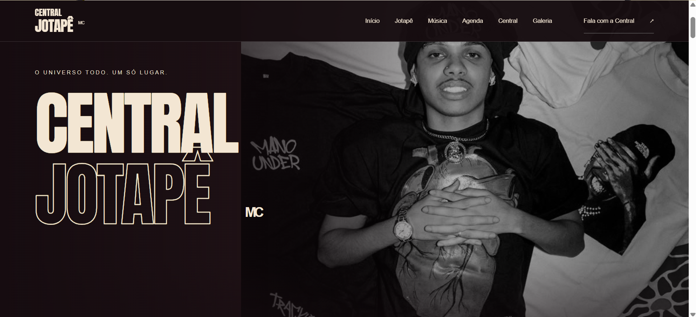
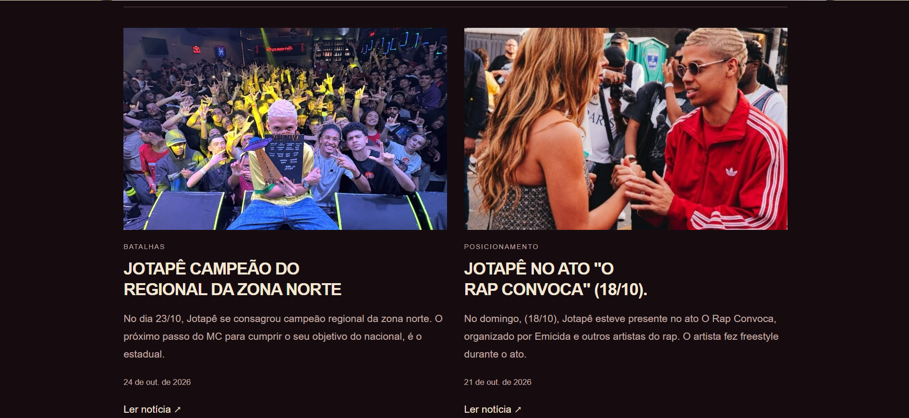
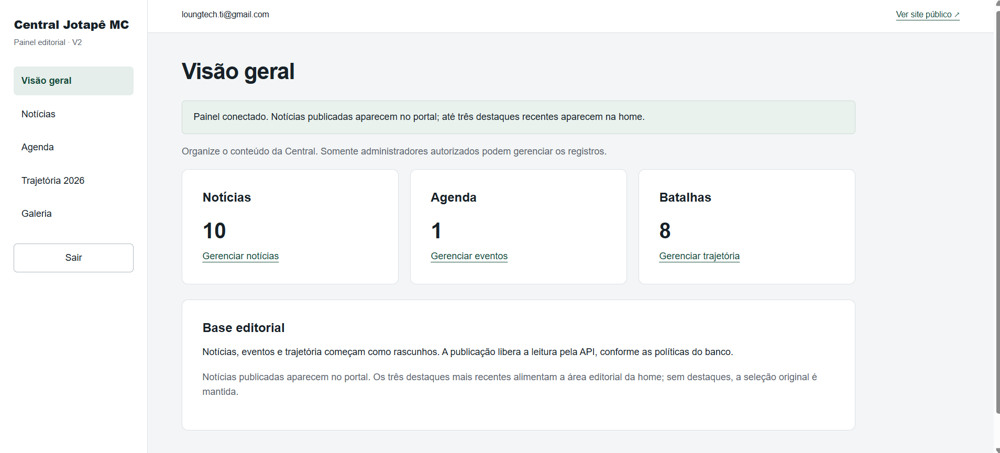
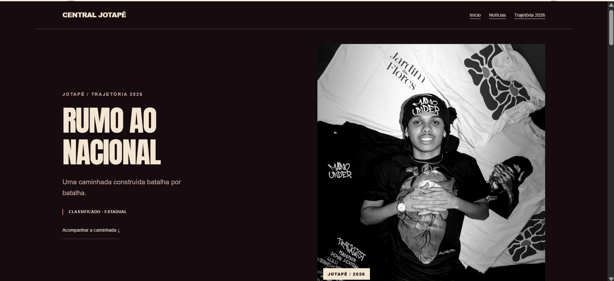

# 🎤 Central Jotapê MC

### Portal de notícias, conteúdo artístico e gerenciamento editorial


O **Central Jotapê** é um portal de conteúdo e notícias desenvolvido para a comunidade que acompanha o artista Jotapê MC.

Criado pela **Loung Tech**, o projeto reúne notícias, trajetória artística e competitiva, agenda de eventos, galeria de imagens e informações sobre o artista.

Além da experiência pública, a aplicação conta com um **CMS (Content Management System)** próprio, permitindo que administradores gerenciem conteúdos, notícias, eventos e informações da trajetória diretamente por uma interface protegida.

O projeto foi desenvolvido com **HTML, CSS e JavaScript puro**, integrando Supabase para autenticação, armazenamento e persistência de dados.

🌐 **Site:** https://central-jotape.vercel.app/

> O endereço acima é o domínio de produção documentado no repositório. A disponibilidade do deploy depende da configuração e publicação do ambiente.

---

## 🎯 Objetivo do projeto

Desenvolver uma plataforma digital centralizada para divulgar notícias, eventos e conteúdos relacionados ao artista, oferecendo também autonomia editorial à equipe responsável.

O projeto busca resolver três necessidades principais:

- Centralizar informações e conteúdos em um único portal.
- Permitir atualizações sem necessidade de editar o código-fonte.
- Disponibilizar uma experiência responsiva para os visitantes.

---

## ✨ Funcionalidades

### 📰 Portal de notícias

- Listagem de notícias publicadas.
- Página individual para cada matéria.
- Identificação das matérias por slug.
- Destaques dinâmicos na página inicial.
- Paginação de notícias.
- Controle de publicação e agendamento.

Os conteúdos publicados são consultados no Supabase.

### 🔐 Painel administrativo

Um CMS próprio permite gerenciar os conteúdos do portal.

**Funcionalidades administrativas:**

- Login e logout.
- Autorização por perfil.
- Dashboard com indicadores de conteúdo.
- Cadastro, edição e exclusão de notícias.
- Gerenciamento de rascunhos.
- Publicação e despublicação.
- Agendamento de notícias.
- Administração de eventos.
- Gerenciamento da trajetória competitiva.
- Upload de imagens.

A área administrativa é restrita a usuários autorizados.

### 📅 Agenda de eventos

- Cadastro de eventos pelo painel.
- Data, horário e localização.
- Descrição do evento.
- Imagem e link de ingresso opcionais.
- Publicação e despublicação.
- Exibição de eventos futuros na página inicial.

A agenda consulta eventos publicados e utiliza o fuso horário `America/Sao_Paulo` nas regras de exibição.

### 🏆 Trajetória 2026

Uma seção dedicada ao acompanhamento da trajetória competitiva do artista.

- Registro de etapas e batalhas.
- Organização de resultados.
- Acompanhamento de status.
- Conteúdos relacionados à trajetória.
- Gerenciamento pelo painel administrativo.

### 📸 Galeria de imagens

- Galeria de fotografias.
- Carrossel de imagens.
- Visualização ampliada (lightbox).
- Navegação por teclado.
- Interações por toque em dispositivos compatíveis.
- Adaptação a diferentes tamanhos de tela.

### 🔑 Recuperação de acesso

O painel contempla fluxo de recuperação de senha:

- Solicitação de redefinição por e-mail.
- Página de redefinição.
- Validação de sessão.
- Retorno ao login.

A entrega dos e-mails depende da configuração do serviço de autenticação e do provedor SMTP.

---

## 📸 Demonstração visual

### Página inicial



### Notícias



### Painel administrativo



### Trajetória competitiva



> **Nota:** as imagens acima são caminhos reservados para screenshots. Adicione capturas reais à pasta `docs/screenshots/` antes de publicar este README.

---

## 🛠️ Tecnologias utilizadas

| Tecnologia | Responsabilidade |
|---|---|
| HTML5 | Estrutura das páginas |
| CSS3 | Design, animações e responsividade |
| JavaScript | Interatividade e lógica da aplicação |
| Supabase Auth | Autenticação de administradores |
| PostgreSQL | Persistência de notícias, eventos e trajetória |
| Supabase Storage | Armazenamento de imagens |
| Row Level Security | Proteção de acesso aos dados |
| Node.js | Scripts e ferramentas de desenvolvimento |
| Playwright | Testes automatizados de navegador |
| Vercel | Build e hospedagem |

**Diferencial técnico:** a aplicação utiliza JavaScript puro, sem um framework de interface.

Essa abordagem permite demonstrar domínio de conceitos fundamentais do desenvolvimento web, incluindo manipulação do DOM, modularização, comunicação com APIs e gerenciamento de estados de interface.

---

## 🏗️ Arquitetura

A plataforma separa a interface pública, o ambiente administrativo e a persistência de dados.

```text id="9gk2ar"
                  VISITANTES
                      |
                      v
               PORTAL PÚBLICO
               HTML / CSS / JS
                      |
          +-----------+-----------+
          |                       |
          v                       v
       NOTÍCIAS               AGENDA /
       GALERIA                TRAJETÓRIA
          |                       |
          +-----------+-----------+
                      |
                      v
               SUPABASE API
                      |
                 POSTGRESQL
                      ^
                      |
              PAINEL ADMINISTRATIVO
                      ^
                      |
              SUPABASE AUTH + RLS
                      ^
                      |
                 EDITORES
```

### Decisões arquiteturais

**1. Separação entre área pública e administrativa**

O conteúdo público pode ser consultado pelos visitantes, enquanto operações de gerenciamento exigem autenticação e autorização.

**2. CMS integrado ao banco de dados**

O painel permite publicar e gerenciar conteúdos persistidos no Supabase sem modificar manualmente os arquivos HTML.

**3. Controle editorial**

Notícias e eventos utilizam estados de publicação para diferenciar conteúdos em preparação daqueles disponíveis publicamente.

**4. Segurança no banco**

As políticas RLS complementam a autorização da interface, restringindo operações administrativas.

**5. Build estático**

O projeto utiliza um processo de build que prepara os arquivos públicos para hospedagem na Vercel, mantendo documentação, testes e arquivos internos fora da publicação.

---

## 📂 Estrutura do projeto

```text id="ag63p8"
central-jotape/
├── admin/                 # Painel administrativo
├── assets/                # Imagens, ícones e fontes
├── config/                # Configurações públicas
├── css/                   # Estilos
├── docs/                  # Documentação técnica
├── js/
│   ├── admin/             # Módulos administrativos
│   └── public/            # Funcionalidades públicas
├── scripts/               # Build e servidor local
├── supabase/              # Migrations e recursos do banco
├── tests/                 # Testes automatizados
├── index.html             # Página inicial
├── noticias.html          # Listagem de notícias
├── noticia.html           # Página individual
├── galeria.html           # Galeria
├── trajetoria-2026.html   # Trajetória competitiva
├── package.json
└── README.md
```

---

## 🚀 Como executar localmente

### Pré-requisitos

- Node.js 22 ou superior.
- npm.
- Git.
- Projeto Supabase configurado para utilizar as funcionalidades dinâmicas.

### 1. Clone o repositório

```bash id="8dca2m"
git clone https://github.com/nandoalvesferreira20-png/central-jotape.git

cd central-jotape
```

### 2. Instale as dependências

```bash id="rlh3h4"
npm ci
```

### 3. Inicie o ambiente local

```bash id="azf14y"
npm run dev
```

Acesse:

http://127.0.0.1:4175

O painel administrativo está disponível em:

http://127.0.0.1:4175/admin/login.html

As páginas devem ser servidas por HTTP. Abrir os arquivos diretamente pelo sistema de arquivos pode impedir o funcionamento dos módulos JavaScript.

### 4. Configure o Supabase

A integração utiliza as seguintes variáveis no ambiente de build:

```dotenv id="f18n0i"
SUPABASE_URL=
SUPABASE_PUBLISHABLE_KEY=
```

Consulte a documentação técnica antes de aplicar migrations ou configurar permissões.

**Importante:** não utilize chaves administrativas ou senhas privadas na configuração pública do frontend.

### 5. Execute o build

```bash id="erjtc1"
npm run build
```

Os arquivos de publicação são gerados na pasta `dist/`.

---

## 🧪 Testes e validação

O projeto possui testes automatizados para regras de negócio e interações da interface.

### Testes automatizados

```bash id="vufr5n"
npm test
```

### Testes de navegador

```bash id="ir5m4l"
npm run test:browser
```

Os testes de navegador utilizam Playwright.

### Build

```bash id="3r2qcp"
npm run build
```

As verificações contemplam funcionalidades como autenticação, autorização, publicação de conteúdo, notícias, trajetória, galeria e responsividade.

---

## 🔐 Segurança

O projeto adota medidas de proteção para operações administrativas e persistência de dados:

- Autenticação com Supabase Auth.
- Autorização administrativa por perfil.
- Row Level Security no PostgreSQL.
- Separação entre consultas públicas e operações privadas.
- Validação de URLs utilizadas no CMS.
- Restrições de upload de arquivos.
- Proteção de páginas administrativas contra indexação.
- Configuração de credenciais privadas fora do código público.
- Verificações de acesso em operações de gerenciamento.

O processo de publicação também separa os arquivos necessários ao site dos recursos utilizados exclusivamente durante o desenvolvimento.

---

## 🧠 Desafios técnicos e aprendizados

### Desenvolvimento sem frameworks de interface

Construir o portal com HTML, CSS e JavaScript puro exigiu organizar componentes visuais, eventos, estados e funcionalidades sem depender de React ou outros frameworks.

### Construção de um CMS próprio

O gerenciamento de notícias, agenda e trajetória exigiu desenvolver formulários, validações, persistência, autenticação e regras editoriais.

### Integração com Supabase

A implementação envolveu integração de autenticação, banco de dados, armazenamento e políticas de autorização.

### Conteúdo dinâmico em uma aplicação estática

O projeto combina arquivos estáticos com conteúdo consultado dinamicamente, mantendo um processo de publicação compatível com hospedagem na Vercel.

### Segurança e controle de acesso

O painel administrativo exige diferenciar usuários autenticados de usuários efetivamente autorizados a editar conteúdos.

### Testes de interface

A utilização de Playwright permite verificar fluxos de navegação e interações em um navegador real.

---

## 📈 Possíveis evoluções

- [ ] Ampliar os indicadores do dashboard administrativo.
- [ ] Implementar busca avançada no portal.
- [ ] Melhorar os recursos de organização editorial.
- [ ] Expandir a acessibilidade das interfaces.
- [ ] Adicionar métricas de visualização das notícias.
- [ ] Aprimorar a pré-renderização de metadados de matérias individuais.
- [ ] Ampliar a cobertura de testes automatizados.

---

## 📚 Documentação adicional

- [Configuração do Supabase e CMS](docs/SUPABASE.md)
- [Agenda e regras de publicação](docs/AGENDA.md)
- [Recuperação de senha](docs/RECUPERACAO-SENHA.md)

A pasta `docs/` também contém registros técnicos e históricos do desenvolvimento.

---

## 👨‍💻 Desenvolvimento

**Fernando Ferreira Alves**

Estudante de Engenharia de Software, com foco em desenvolvimento de aplicações, automações, dados e inteligência artificial.

A Central Jotapê faz parte dos projetos desenvolvidos por meio da **Loung Tech**, demonstrando experiência prática na criação de soluções web com gerenciamento de conteúdo, autenticação, banco de dados e interfaces responsivas.

### Contato

[](https://github.com/nandoalvesferreira20-png)
[](https://www.instagram.com/fernandev.tech/)
[](https://loung-tech.vercel.app/)

---

<p align="center">
  <strong>Central Jotapê — Tecnologia conectando artistas, conteúdo e comunidade.</strong>
</p>

<p align="center">
  Desenvolvido pela Loung Tech.
</p>
